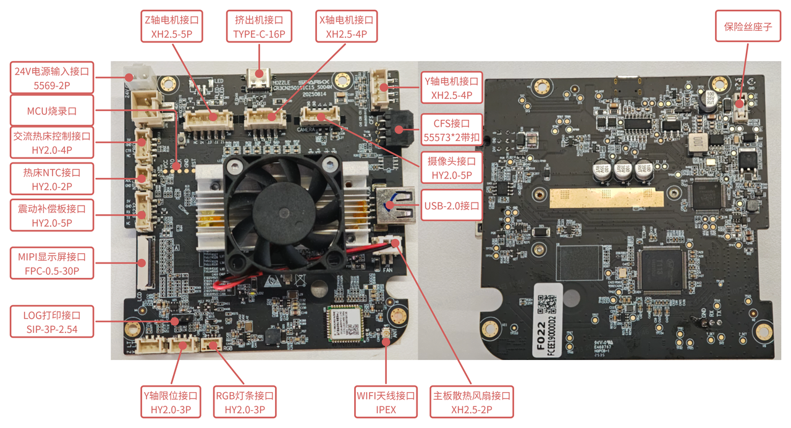
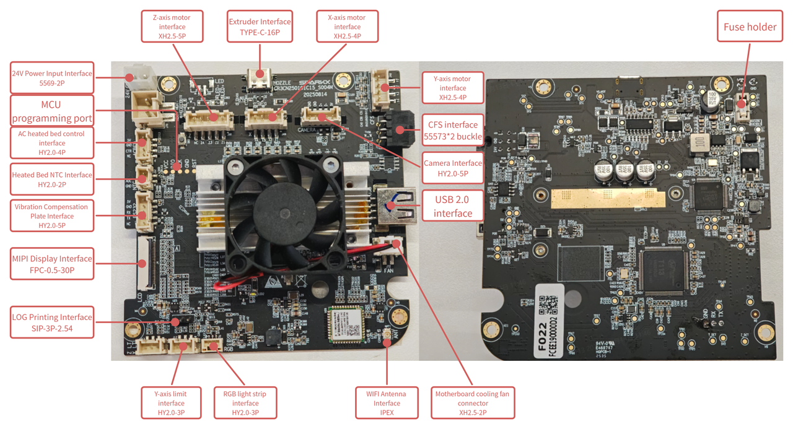
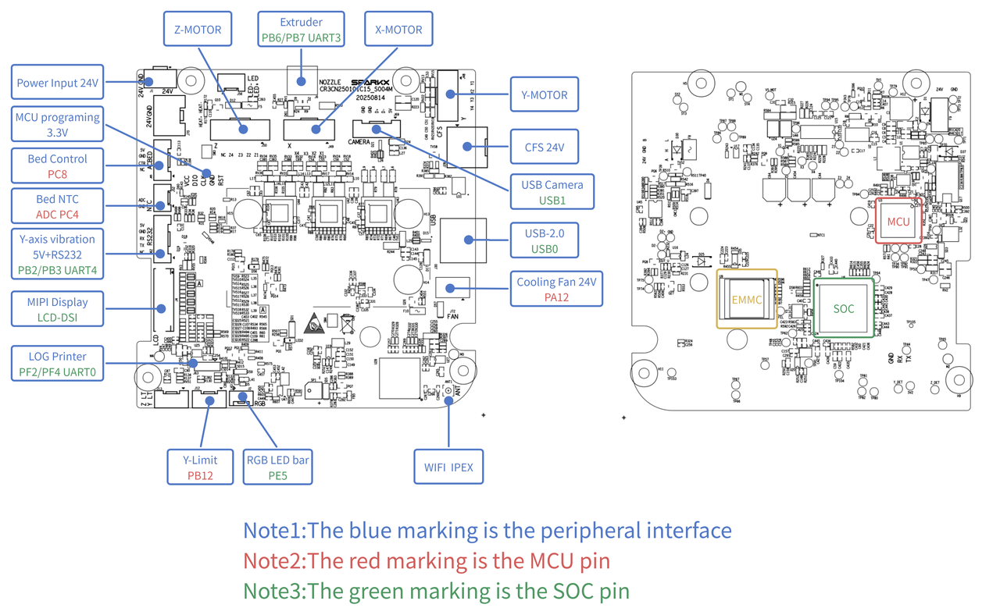
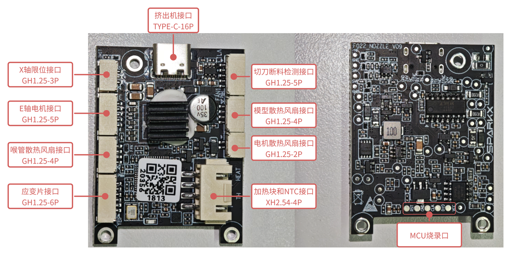
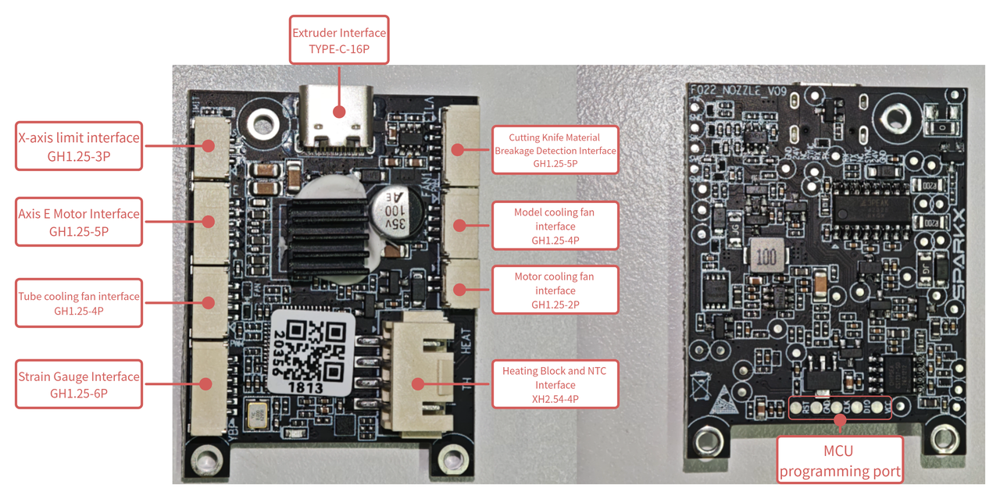
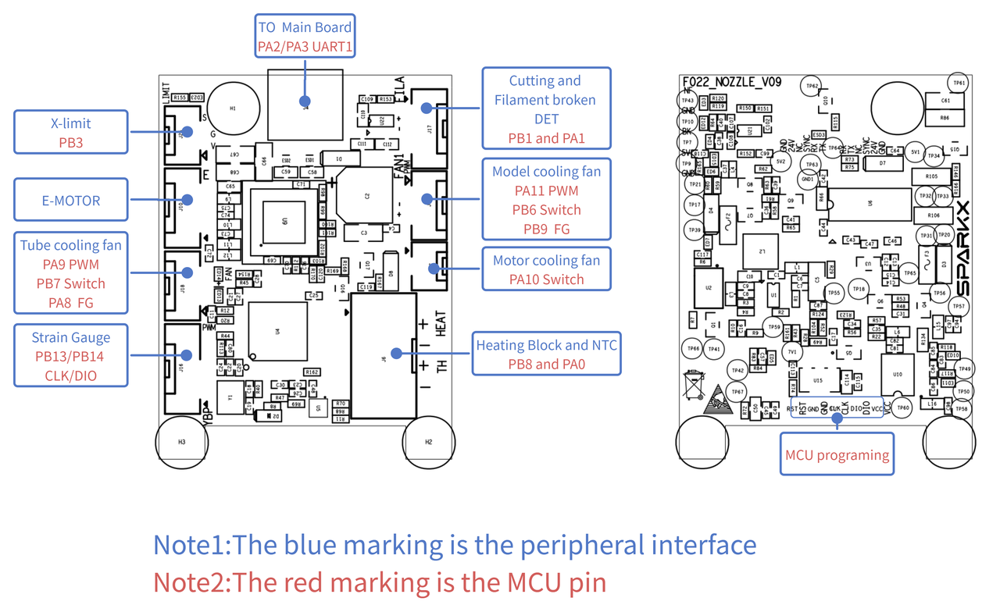
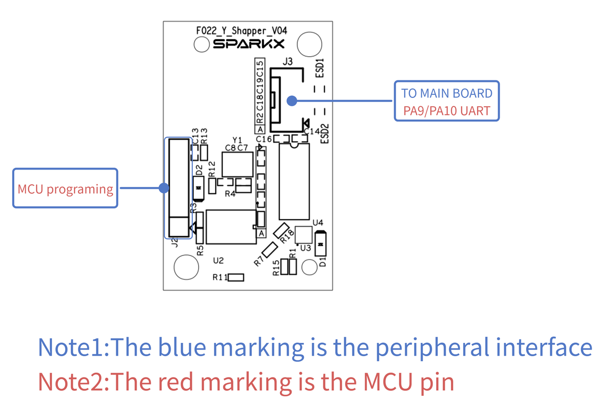

# Board interfaces and pinouts / 板卡接口与引脚定义

[Hardware documentation / 硬件资料](../README.md)

| Document / 资料 | Preview / 预览 |
| --- | --- |
| Mainboard (Chinese) / 主板接口（中文） |  |
| Mainboard (English) / 主板接口（英文） |  |
| Mainboard pinout / 主板引脚定义 |  |
| Extruder board (Chinese) / 挤出板接口（中文） |  |
| Extruder board (English) / 挤出板接口（英文） |  |
| Extruder board pinout / 挤出板引脚定义 |  |
| Y-axis vibration compensator / Y 轴振动补偿板接口 |  |

## License / 许可证

Images / 图片: [OCL v1.1](../../LICENSES/OCL-1.1.txt)

Documentation / 说明文档: [CC BY-NC 4.0](../../LICENSES/CC-BY-NC-4.0.txt)

[License scope / 授权范围](../../LICENSE)
